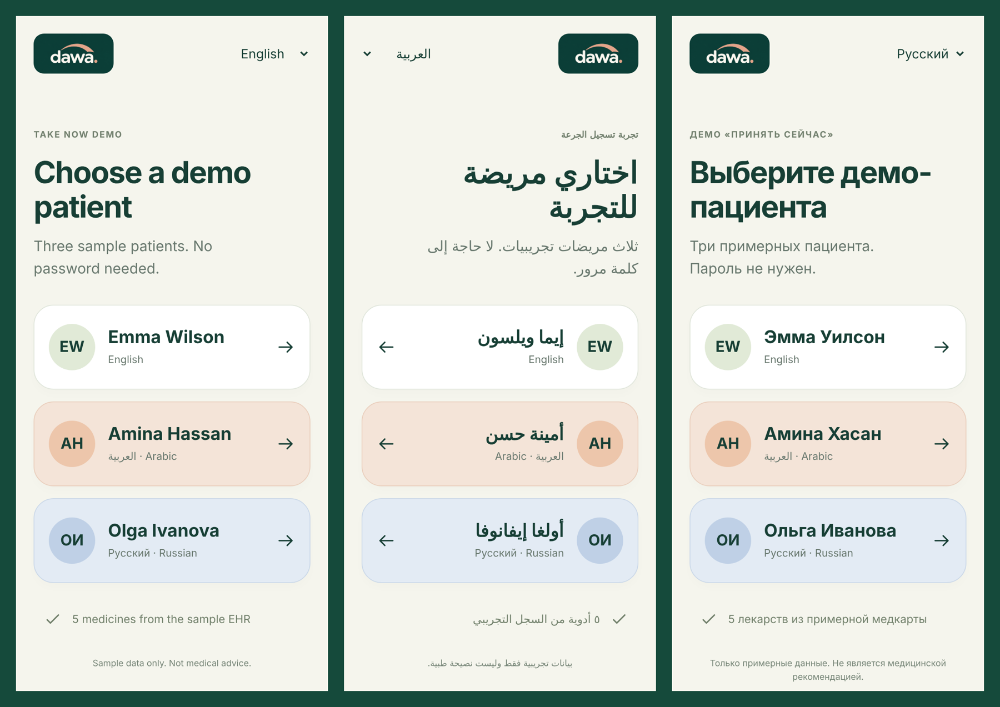
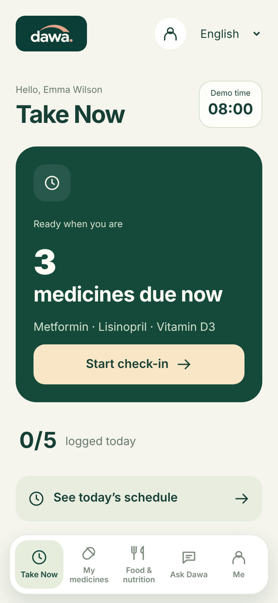
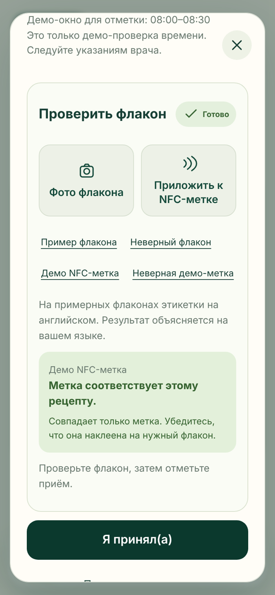
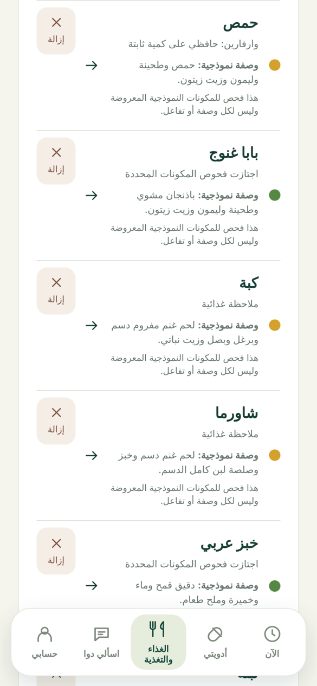
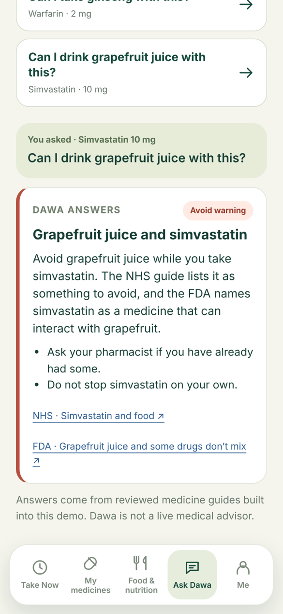
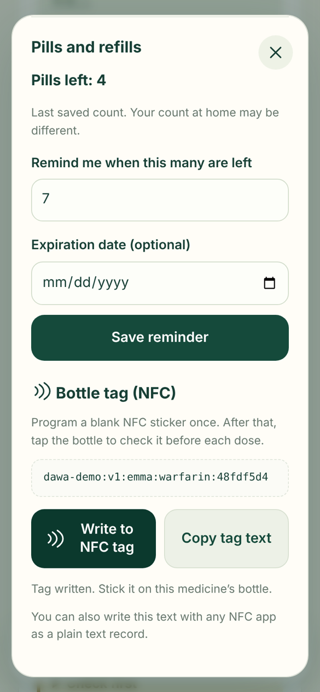

# dawa. · Take Now

**A medication check-in app for people who take many medicines, in English, Arabic and Russian.**
Before each dose it checks that you are holding the right bottle, by photo or NFC tag. It also explains each medicine in plain language and reads it aloud, and it warns about foods and drinks that clash with your medicines.

**[Live demo →](https://dawa-next-vercel-source-ask-dawa.vercel.app/)** · pick a sample patient, no sign-up



> Demo with synthetic patients and data only. It is not medical advice and not a medical device.

---

## The problem

People on five or more medicines (polypharmacy) are expected to read small print in English, tell look-alike tablets apart, remember schedules that differ by medicine, and know which foods to avoid. That plan fails for patients who:

- read Arabic, Russian or another language better than English
- have low vision, hearing loss or memory problems
- rely on a family member or caregiver to keep track
- eat foods their printed diet advice never mentions

Taking the wrong bottle, taking a dose at the wrong time and dangerous food combinations (grapefruit with simvastatin, cranberry juice with warfarin) are all preventable.

## What dawa does

| | |
|---|---|
| **Take Now check-in** | Shows what is due now, walks through each dose and logs it. Doses outside the 30-minute window are blocked with a clear "Do not take yet". |
| **Bottle check before "I took it"** | Photograph the label (read on the device with Tesseract OCR, so photos never leave the phone) or tap the bottle's NFC tag. A wrong medicine or strength is flagged before the dose is logged. |
| **Medicine cards** | Plain-language directions in the patient's language, a **Listen** button with recorded audio in all three languages, pills left, refill reminder and expiry date. |
| **"Do not take with" warnings** | Food and drink rules for each medicine, each linked to its source (NHS, FDA, Cambridge University Hospitals). |
| **Food & nutrition** | The patient's own foods, including Arabic dishes, are checked against their medicines with traffic-light labels. Lab results from the health record lead to food ideas. |
| **Ask Dawa** | Questions like "Can I drink grapefruit juice with this?" get answers from reviewed guides, not a chatbot. Emergency wording points straight to emergency services. |
| **Caregiver alerts** | A family member can be alerted about missed or skipped doses, in *their* language. |
| **Accessibility** | Four text sizes, high contrast, reduced motion, adjustable speech speed and a full right-to-left layout for Arabic. |

<p>
  
  
  
  
</p>

## Languages

| | English | العربية Arabic | Русский Russian |
|---|:-:|:-:|:-:|
| Interface | ✓ | ✓ (right to left) | ✓ |
| Medicine names and directions | ✓ | ✓ | ✓ |
| Recorded voice for every medicine | ✓ | ✓ | ✓ |
| Food names, food checks, Ask Dawa | ✓ | ✓ | ✓ |
| Sample patient | Emma Wilson | Amina Hassan | Olga Ivanova |

Switch language from the menu at the top of any screen. Each caregiver can choose their own language. All translations are demo-quality and need review by native-speaking pharmacists before clinical use.

## NFC bottle tags



Each bottle can carry a cheap NFC sticker (NTAG213/215). Tapping it during check-in confirms you picked up the right medicine.

**You need:** an Android phone, Chrome, NFC turned on, and the app opened over HTTPS (the Vercel link works). iPhone browsers do not support Web NFC, so iPhone users check bottles with a photo instead.

1. Open **My medicines → Details** for a medicine and tap **Write to NFC tag**.
2. Hold a blank sticker against the back of the phone until it says **Tag written**, then stick it on that bottle.
3. At dose time, tap **Tap NFC tag** and hold the phone to the bottle. A match unlocks **I took it**. A different medicine's tag is named, so you know which bottle you are holding.

You can also tap a tagged bottle while the app is closed. The tag opens dawa straight to that medicine's dose and checks it.

A tag holds two records: a link (`https://…/#tag=<payload>`) and a plain-text payload, `dawa-demo:v1:<patient>:<medicine>:<fingerprint>`. Any NFC app can write the text version. Use **Copy tag text** in the medicine details to get it.

<br clear="right">

## Run it locally

No build step and no dependencies, just static files and ES modules.

```bash
git clone https://github.com/<your-username>/dawa.git
cd dawa
npm start        # http://localhost:8080
npm test         # unit tests (Node 20+)
```

Browser walkthroughs (optional, needs Python Playwright):

```bash
python3 scripts/walkthrough.py olga ru http://localhost:8080/   # clicks every screen, reports untranslated text
python3 scripts/nfc_check.py http://localhost:8080/             # end-to-end NFC flow with a simulated Android phone
```

## Deploy

Import the repo into [Vercel](https://vercel.com/new). `vercel.json` already serves `public/` with no build. Any static host works.

## Project structure

```
public/                    the whole app (served as-is)
  index.html, app.js       page shell and interface
  style.css
  next-core.mjs            patients, dose timing, bottle and tag checks, caregiver alerts
  core.mjs                 sample health record, medicines, translated directions
  nfc.mjs                  Web NFC: read, write and tap-to-open bottle tags
  bottle-ocr.mjs           on-device label reading (Tesseract.js, files in ocr/)
  food-check.mjs, food-search.mjs, demo-food-evaluation.mjs   food checks
  medicine-warnings.mjs    "do not take with" rules and sources
  ask-dawa.mjs             curated question answering
  supply.mjs, ehr-supply.mjs   pill counts, refills, expiry
  voice.mjs, voice-catalog.mjs, voices/   recorded medicine audio (en, ar, ru)
  locales.mjs, next-locales.mjs, ask-locales.mjs, ru-locales.mjs   translations
  sw.js, manifest.webmanifest   installable, works offline
tests/                     node:test unit tests
scripts/                   local server, browser walkthroughs, screenshot generator
docs/screenshots/
```

## Built with

Plain JavaScript (ES modules, no framework) · [Tesseract.js](https://github.com/naptha/tesseract.js) for on-device OCR · Web NFC · installable PWA. Everything runs in the browser, and patient data stays in the browser's local storage.

Groundwork for spoken input (Whisper running on the device through [Transformers.js](https://github.com/huggingface/transformers.js) and ONNX Runtime Web, in `voice-worker.mjs` and `vendor/`) is included but not yet connected to any screen.

## What's new in 1.1

- **Russian** added throughout: interface, food checks, Ask Dawa, caregiver language, voice, plus a Russian-speaking sample patient.
- **NFC tags that work end to end.** You can now write a tag from the app, and tapping a tagged bottle opens the app on that dose. Clear messages cover NFC being off, permission denied, iPhone, an unknown tag, another medicine's tag and another patient's tag.
- Unit tests, browser walkthrough scripts and CI.

## Safety and data

All patients, prescriptions, lab results and bottles are synthetic. dawa does not diagnose, prescribe or replace a pharmacist. Food and drink rules summarise the linked public guidance and are not a complete interaction check. The app also says plainly what a check proves: an NFC or label match confirms the tag or label, not what is inside the bottle.
